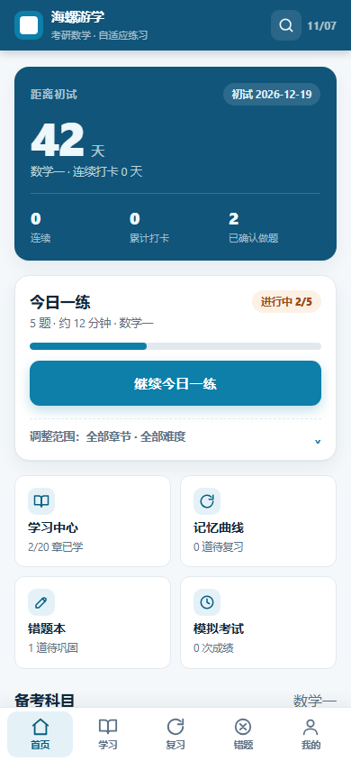
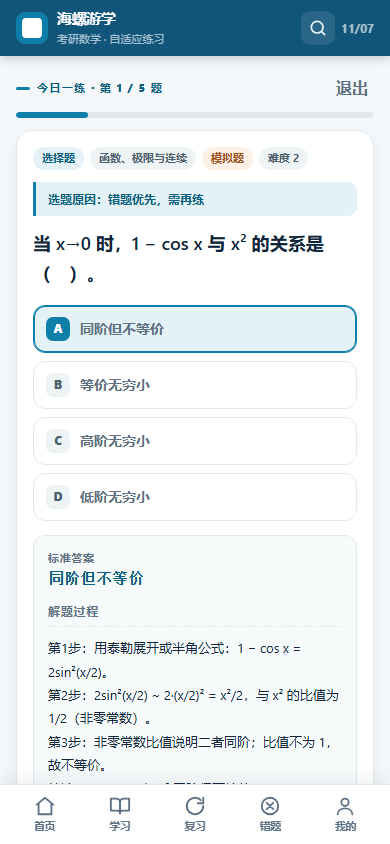

# 海螺游学 · 对标上线应用的优化报告

> 日期：2026-11-07  
> 范围：内容质量、移动端体验、性能与离线、工程质量  
> 结论：把「能用」的练习页升级成「像上线产品」的完整学习工具，并修掉了会直接伤害信任的内容错误。

## 1. 对标对象与判断标准

考研数学用户实际会同时打开的产品大致三类，本轮的取舍都按它们的共识来：

| 类型 | 代表 | 值得对标的点 | 本项目原来的差距 |
| --- | --- | --- | --- |
| 题库/刷题类 | 猿题库、考研帮 | 首屏即练、单题快速判题、错题自动沉淀、做题进度不丢 | 无倒计时、无返回键、退题后找不到进度 |
| 记忆/习惯类 | Anki、百词斩、扇贝 | 记忆曲线排期、打卡可视化、连续天数激励 | 有记忆曲线但没有「今天该复习几道」的入口感 |
| 系统工具类 | 微信小程序式学习工具 | 底部 Tab、单手可达、深色模式、离线可用、安装到桌面 | 无深色模式、缓存永久不更新、iOS 图标缺失 |

判断标准不是功能数量，而是三件事：**打开后 10 秒内知道该做什么、做题过程不打断、对答案时信任内容和数据**。

## 2. 诊断：本轮修掉的问题

### 内容层（最伤信任）

| 问题 | 证据 | 处理 |
| --- | --- | --- |
| 同一题干两套答案，其中一个是错的 | 8 组，例如「级数 Σ2^n/n! 的敛散性」同时存在「收敛」与「发散」 | 人工确认后删除错误项，保留正确答案 |
| 同一题重复入库 | 115 道重复（数学一 98 道为主），会在一份题单里抽到两遍 | 按归一化题干去重，题库 2391 → 2285 |
| 选择题选项重复 | 42 道出现两个相同选项，其中一个还是标准答案 | 去重并保证答案仍在选项中 |
| 矩阵题选项被拆成行碎片 | 3 道（分块矩阵求逆、二次型矩阵），答案根本不在选项里 | 重写为合法的单行矩阵选项与解析 |
| 有知识小节但一道题都没有 | 5 个小节（多元极限/复合与隐函数求导/极大无关组/反常积分/微分中值定理） | 补 9 道题、2 道题重新归类 |
| 题目挂错科目 | 一道 p 级数题挂在「数学二」（数学二不考无穷级数） | 移到数学一「无穷级数 / 正项级数判别法」 |
| 答案写法不统一 | 「π / 1π」「Ce^(x) / Ce^(1x)」 | 统一写法 17 处 |
| 解析里的「选 X」与选项位置对不上 | 去重选项后字母错位，40 余处解析会指错选项 | 按答案位置重算字母，修正 45 处 |

### 体验层

- **没有返回键**：安卓返回直接退出应用。→ 接入 History API，逐页返回并恢复滚动位置。
- **切页后停在上一页的滚动位置**：长列表点进新页会从中间开始。→ 新页回到顶部，返回时恢复原位置。
- **填空题无法用键盘「完成」提交**：1250 道填空题全靠点按钮。→ 回车提交，输入框标注 `enterkeyhint`。
- **交卷一按就判分**：未作答也算错，且不可撤销。→ 交卷前二次确认，考试中可退出（需确认）。
- **没有新手引导**：首次进入看到空统计，不知道该设什么。→ 首课引导：选科目、定题量、设初试日期。
- **没有考研倒计时**：这是考研类产品的第一屏信息。→ 首页 Hero 显示距初试天数 + 连续打卡。
- **没有搜索**：用户想查「洛必达」只能翻章节。→ 按题干、解析、答案、章节、讲义全文检索。
- **选项双重标记**：原生单选圆点 + 字母徽标并排，视觉噪声。→ 隐藏原生圆点，用字母徽标表达选中态。
- **深色模式下部分按钮不可见**：`.secondary` 用深蓝文字配深色底。→ 引入语义色变量，深色模式单独取值。
- **无深色模式 / 无字号调节**：夜间刷题刺眼。→ 跟随系统 / 浅色 / 深色三档，标准 / 大字两档。

### 工程层

- **Service Worker 永久缓存旧版本**：cache-first 且没有 `activate` 清理，改版后用户永远拿不到新代码。→ 导航网络优先、静态资源 stale-while-revalidate、版本化缓存 + 更新提示。
- **1.44 MB 题库裸传**：手机首屏等待明显。→ 服务端 gzip 后 **162 KB**，并加 ETag/304。
- **每帧 O(n²) 查找**：渲染里反复 `questions.find`（2391 题 × 多次）。→ 建 id / 科目 / 章节 / 检索索引。
- **manifest 用绝对路径 + 只有 SVG 图标**：部署到子目录会 404，iOS 加不到桌面。→ 改相对路径，补 192/512/maskable/apple-touch PNG。
- **发布目录手工维护**：`publish-site/` 与根目录靠人肉同步，必然漂移。→ `npm run build` 生成，显式文件清单。
- **只有核心逻辑测试**：改 UI 无回归保护。→ 新增题库质量门禁与 14 个页面的渲染冒烟测试。

## 3. 本轮交付

### 产品与交互

- 首页重构：倒计时 Hero + 今日一练卡（状态药丸、进度条、主 CTA）+ 四宫格快捷入口 + 科目切换 + 5 周打卡日历。
- 首课引导层：科目 / 题量 / 初试日期，一次设完；老用户升级不打扰。
- 新增「我的」：考试日期、每日题量、主题、字号、数据导出/导入/清空、安装引导、版本与题库统计。
- 新增搜索页与题目详情页：搜到即可看解析或直接练这道题。
- 学习中心与章节页：章节显示已练题数、正确率进度，小节显示题数。
- 做题页：进度、题型/难度/来源标签、选题原因、判题结论、标准答案、分步解析、易错点、上一题、自动保存提示。
- 考试页：倒计时、答题卡、交卷确认、退出确认、成绩归档与逐题解析。
- 深色模式与字号：跟随系统实时切换，变量级换肤。

### 工程与数据

- 新增 `test-data.mjs`：必填字段、答案在选项中、选项唯一、无重复题干、跨科目答案等价、章节与小节覆盖、组卷不重复。
- 新增 `test-views.mjs`：14 个页面渲染 + 转义检查 + undefined/NaN 检查。
- 新增 `tools/fix-bank.mjs`（去重/改错/统一写法）、`tools/patch-gaps.mjs`（补空档/修碎片题）、`tools/build-site.mjs`（发布构建）、`tools/gen-icons.py`（PNG 图标）。
- 新增 `npm test` / `npm run build` / `npm run data:fix` / `npm run icons`。
- Service Worker 改为按资源类型分策略，并支持「有新版本可用 → 刷新」。
- `server.mjs`：gzip、ETag/304、缓存头、路径越界拦截、安全响应头。

### 关键数字

| 指标 | 优化前 | 优化后 |
| --- | --- | --- |
| 题库 | 2391 道（含 115 道重复、8 组错答案） | 2285 道（去重、改错、补齐空档） |
| 重复选项 | 42 道 | 0 |
| 无题小节 | 5 个 | 0 |
| 题库传输（gzip） | 1441 KB | 162 KB |
| 页面渲染中的线性查找 | 每帧多次 `find` | 索引 Map |
| 自动化测试 | 1 个文件 | 3 个文件 + 浏览器功能校验 |
| 深色模式 / 搜索 / 返回键 / 引导 | 无 | 有 |

## 4. 验证

```text
node test-core.mjs   全部通过（组卷、判分、复习、难度）
node test-data.mjs   全部通过（2285 道题的内容质量门禁）
node test-views.mjs  全部通过（14 个页面渲染冒烟）
浏览器功能校验        10/10：返回键、滚动恢复、回车提交、交卷确认、
                     manifest、PNG 图标、Service Worker、深色变量
```

界面在 390 × 844（主流手机）下逐页截图核对，控制台无报错。





## 5. 取舍与未做的部分

- **没有引入框架或构建工具**：项目是零依赖经典脚本，本轮延续这一取舍；页面都是纯字符串视图，测试成本低于引入 React 后的快照测试。
- **没有接大模型 / 拍照判题**：这是 M2 范围，且需要后端与密钥管理，不适合塞进纯前端仓库。
- **没有做多端同步**：仍以 localStorage + 导出文件为准；如要做账号体系，需要后端与隐私设计。
- **题库扩量没做**：本轮优先修错而不是堆量。继续加题时，`npm test` 会拦住重复题、错选项和空小节。
- **真题比例**：目前题库全部为自建模拟题（`kind: mock`），UI 如实标注，不冒充真题。

## 6. 下一步建议（按投入产出排序）

1. **内容继续修**：把解析里「选 C」这类与选项顺序绑定的表述逐步改成「答案为【原文】」，彻底摆脱选项顺序依赖（本轮已自动校正 45 处错位字母，并加了门禁）。
2. **题目分片加载**：按科目拆 JSON，首屏只取当前科目（预计首屏再降 60%），其余空闲预取。
3. **学习报告**：按周聚合正确率、章节薄弱点，给出「今天优先复习哪 3 章」的建议。
4. **拍照作答**：接入模型前先把上传、置信度、人工确认与失败回退的交互做出来（PRD 已定义）。
5. **微信小程序**：复用同一份题库与组卷逻辑，`core.js` 可直接被小程序引用。
